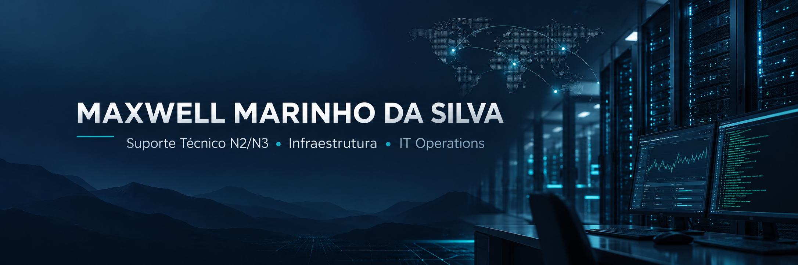

 

# Maxwell Marinho da Silva

### Analista de Suporte Técnico · N2/N3 · Infraestrutura de TI · IT Operations

Suporte e infraestrutura para manter ambientes corporativos **estáveis, documentados e disponíveis** — com automação aplicada aos desafios da operação.

 

 

 

[Sobre](#-sobre-mim) · [Competências](#-competências) · [Projetos](#-projetos-em-destaque) · [Experiência](#-experiência-profissional) · [Formação](#-formação-e-certificações) · [Contato](#-vamos-conversar)

 

---

## 👋 Sobre mim

Profissional de Tecnologia da Informação com **mais de 12 anos de experiência** em suporte técnico, infraestrutura e operações de TI. Minha trajetória combina atendimento **N2/N3**, troubleshooting, gestão de incidentes, continuidade operacional e sustentação de ambientes corporativos.

Atuo com **Linux, Windows Server, Active Directory, redes, bancos de dados, monitoramento e sistemas corporativos**. No contexto atual, trabalho também com análise de logs de aplicações Java/Tomcat, consultas e correções SQL, validação de arquivos XML, JSON e TXT e suporte a integrações.

Uso desenvolvimento e automação como extensão da operação: meus projetos públicos aplicam **Java, integrações HTTP, processamento de arquivos, C++/Arduino e SNMP** a problemas técnicos reais.

<table>
  <tr>
    <td width="33%" valign="top">
      <h3>🧭 Especialidade</h3>
      
Suporte Técnico N2/N3 e Infraestrutura de TI.

    </td>
    <td width="33%" valign="top">
      <h3>⚙️ Contexto</h3>
      
IT Operations, ITSM, incidentes, troubleshooting e continuidade de serviços.

    </td>
    <td width="34%" valign="top">
      <h3>🤖 Diferencial</h3>
      
Automação, integração de sistemas e ferramentas aplicadas à operação.

    </td>
  </tr>
</table>

---

## 🧩 Competências

### Suporte, operações e infraestrutura

### Monitoramento, dados e sistemas

### Automação, desenvolvimento e integrações

---

## 🚀 Projetos em destaque

### 🧾 [Corretor SIPAT 1.0.1](https://github.com/MaxwellMarinhodaSilva/CorretorSipat)

Aplicação desktop em Java 21 que analisa e corrige arquivos posicionais SIPAT, remove protocolos duplicados e recalcula controles com validação pós-gravação — sem alterar o arquivo original.

`Java 21` `Swing` `Maven` `FlatLaf` `JUnit 5` `jpackage`

<strong>Ver principais recursos</strong>

- análise estrutural, dos indicadores e dos protocolos duplicados;
- preservação da primeira ocorrência e remoção controlada das posteriores;
- recálculo de quantidade, somatório de segurança, soma financeira e sequenciais;
- geração de SIP corrigido, relatórios TXT/CSV e log técnico;
- validação independente do arquivo após a gravação;
- histórico local, tema claro/escuro e recursos de acessibilidade.

---

### 🔎 [ConsultaSeloDigital](https://github.com/MaxwellMarinhodaSilva/ConsultaSeloDigital)

Aplicação desktop em Java 21 que centraliza consultas de selos digitais do TJPB, TJRN e TJPE e oferece abertura assistida das consultas do TJAL no portal oficial.

`Java 21` `Swing` `Java HTTP Client` `Jackson` `Apache POI` `PDFBox` `ZXing` `FlatLaf` `Maven`

<strong>Ver principais recursos</strong>

- consultas individuais e em lote;
- importação por TXT, CSV e XLSX;
- estratégias e parsers específicos por tribunal;
- progresso, histórico, visualização de resultados e detalhes;
- exportação em PDF e XLSX e geração de QR Code;
- integração com serviços públicos de consulta.

---

### 🛠️ [IndicadorReal](https://github.com/MaxwellMarinhodaSilva/IndicadorReal)

Aplicação desktop em Java 21 que interpreta registros de erro, localiza matrículas em arquivos JSON e corrige automaticamente o campo `TIPOENVIO`, preservando o arquivo de origem.

`Java 21` `Swing` `Maven` `Jackson` `JSON` `Regex` `FlatLaf`

<strong>Ver principais recursos</strong>

- entrada por arquivo TXT ou texto colado;
- identificação de matrículas e valores por expressões regulares;
- correspondência pelo campo `NUMERO_REGISTRO`;
- atualização somente dos registros identificados;
- geração de JSON corrigido, relatório TXT e log de execução;
- interface com seleção de arquivos, arrastar e soltar, progresso e histórico.

---

### 🌡️ [Monitoramento de Temperatura e Umidade via SNMP](https://github.com/MaxwellMarinhodaSilva/arduino-snmp-zabbix-dht22)

Projeto pessoal que integra Arduino, Ethernet Shield W5100, sensor DHT22, SNMP e Zabbix para disponibilizar leituras de temperatura e umidade.

`Arduino` `C++` `SNMP` `Zabbix` `Ethernet W5100` `DHT22` `Agentuino`

<strong>Ver principais recursos</strong>

- leitura do sensor DHT22 a cada cinco segundos;
- manutenção da última leitura válida em memória;
- implementação de agente SNMP;
- resposta a requisições `GET` do Zabbix;
- disponibilização de temperatura e umidade por OIDs personalizadas.

---

## 💼 Experiência profissional

### Virtus Sistemas

**Suporte Técnico** · `abr. de 2026 – atual`

Suporte especializado a soluções de software para automação de serviços notariais, registrais e de distribuição, com atuação em incidentes de produção, logs Java/Tomcat, bancos de dados SQL, arquivos XML/JSON/TXT, integrações, chamados, SLA e documentação técnica.

### TNS América Latina

**Suporte Técnico Pleno** · `jan. de 2024 – jul. de 2025`  
**Suporte Técnico Júnior** · `jul. de 2022 – jan. de 2024`

Atuação em Suporte Técnico N2/N3 e operações de TI, com diagnóstico e resolução de incidentes, troubleshooting, Service Desk/ITSM, acompanhamento de SLA, análise de problemas, documentação e colaboração com equipes internas e fornecedores.

> A progressão de Júnior para Pleno marcou minha evolução profissional dentro da empresa.

### Rede Menor Preço de Supermercado

**Técnico de Informática** · `jun. de 2015 – out. de 2019`

Suporte técnico e sustentação de ambientes distribuídos entre **12 unidades**, atendendo aproximadamente **200 estações de trabalho**, sistemas ERP, WMS e soluções de frente de caixa/PDV.

<strong>📂 Ver experiências anteriores</strong>

#### Qualitech Informática

**Vendedor** · `mai. de 2014 – mai. de 2015`

Comercialização de equipamentos e soluções de TI, auxiliando clientes na escolha de produtos adequados às suas necessidades.

#### Superbox Brasil Supermercados

**Gerente Comercial** · `set. de 2010 – mar. de 2014`

Atuação nas áreas comercial e de TI, incluindo gestão de sistemas ERP, infraestrutura de redes e apoio a projetos e melhorias de processos.

#### Carrefour Comércio e Indústria Ltda.

**Auxiliar de TI / Suporte Técnico** · `parte da trajetória entre 2005 e 2009`

Suporte a sistemas, equipamentos e soluções de ponto de venda, além de apoio à infraestrutura e à resolução de incidentes.

> O histórico completo de cargos e períodos está disponível no [LinkedIn](https://www.linkedin.com/in/maxwell-m-s/).

---

## 🎓 Formação e certificações

### Formação acadêmica

| Curso | Instituição | Período |
|:--|:--|:--:|
| **Mestrado em Modelagem Matemática e Computacional** | Universidade Federal da Paraíba — UFPB | `2022 – 2024` |
| **Bacharelado em Ciência da Computação** | Faculdade Internacional da Paraíba — FPB | `2018 – 2021` |

### Certificações e formação complementar

<strong>🛡️ Cibersegurança</strong>

- **Fortinet Certified Associate in Cybersecurity** — Fortinet · `2025 – 2027`
- **Fortinet Certified Fundamentals in Cybersecurity** — Fortinet · `2025 – 2027`

<strong>🎫 ITSM, monitoramento e observabilidade</strong>

- **Jira Service Management — ITSM** — Udemy · `2026`
- **Introdução ao Splunk** — Udemy · `2026`

<strong>🐧 Linux, automação e bancos de dados</strong>

- **Linux System Engineer** — LinkedIn Learning · `2024`
- **Learning Linux Shell Scripting** — LinkedIn Learning · `2024`
- **Shell Script** — Udemy
- **Fundamentos em Linux** — WB
- **Python** — Alfahelix
- **SQL Essential** — LinkedIn Learning

---

## 📈 GitHub em números

> As métricas acima são geradas dinamicamente a partir dos repositórios públicos do GitHub.

---

## 📫 Vamos conversar

Se você quiser conversar sobre **Suporte Técnico, Infraestrutura, IT Operations, monitoramento ou automação**, estes são meus canais:

 

  

**Suporte Técnico · Infraestrutura · IT Operations · Monitoramento · Automação**

Maxwell Marinho da Silva

