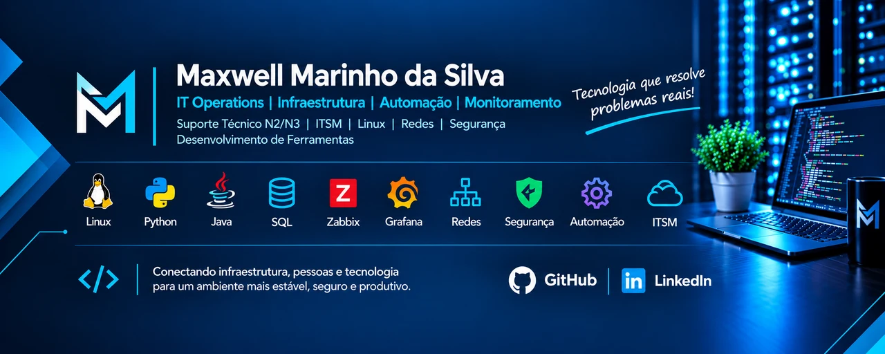
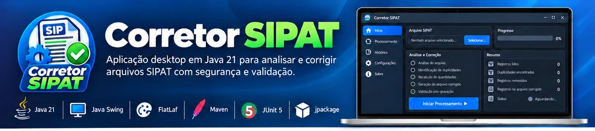
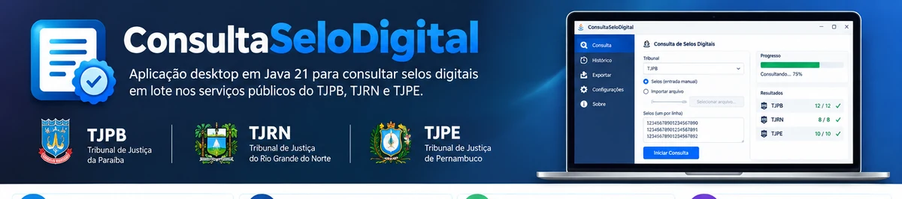
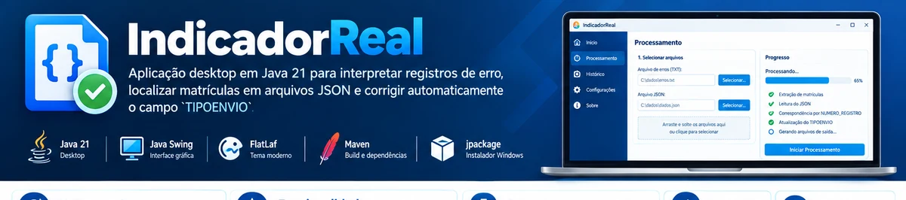
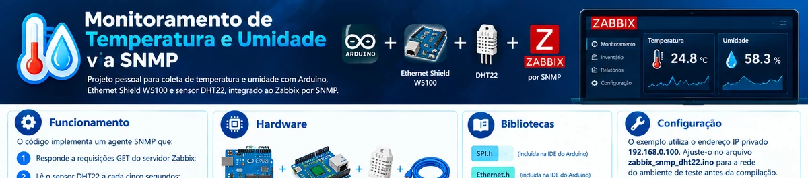

 

# Maxwell Marinho da Silva

<strong>Analista de Suporte Técnico · N2/N3 · Infraestrutura de TI · IT Operations</strong>

Suporte e infraestrutura para manter ambientes corporativos <strong>estáveis, documentados e disponíveis</strong>, com automação aplicada aos desafios da operação.

 

  

<strong>12+ anos de experiência</strong> &nbsp;·&nbsp; <strong>Suporte N2/N3</strong> &nbsp;·&nbsp; <strong>Infraestrutura e Operações</strong> &nbsp;·&nbsp; <strong>Automação aplicada</strong>

  

<a href="#sobre"><strong>Sobre</strong></a> &nbsp;·&nbsp;
<a href="#projetos"><strong>Projetos</strong></a> &nbsp;·&nbsp;
<a href="#experiencia"><strong>Experiência</strong></a> &nbsp;·&nbsp;
<a href="#competencias"><strong>Competências</strong></a> &nbsp;·&nbsp;
<a href="#formacao"><strong>Formação</strong></a> &nbsp;·&nbsp;
<a href="#contato"><strong>Contato</strong></a>

 

---

## 👋 Sobre mim

Profissional de Tecnologia da Informação com **mais de 12 anos de experiência** em suporte técnico, infraestrutura e operações de TI. Minha trajetória combina atendimento N2/N3, troubleshooting, gestão de incidentes, continuidade operacional e sustentação de ambientes corporativos.

Atuo com Linux, Windows Server, Active Directory, redes, bancos de dados, monitoramento e sistemas corporativos. No contexto atual, trabalho também com análise de logs de aplicações Java/Tomcat, consultas e correções SQL, validação de arquivos XML, JSON e TXT e suporte a integrações.

> [!IMPORTANT]
> **Minha especialidade central** é conectar suporte técnico, infraestrutura e operação. Desenvolvimento e automação entram como ferramentas práticas para investigar falhas, tratar dados e integrar sistemas.

### Minha atuação em quatro frentes

- **🧯 Suporte e operação:** N1/N2/N3, troubleshooting, incidentes, Service Desk, ITSM, SLA e documentação técnica.
- **🖥️ Infraestrutura e sistemas:** Linux, Windows Server, Active Directory, redes e sustentação de sistemas corporativos.
- **📊 Monitoramento e dados:** Zabbix, Grafana, SNMP, SQL, bancos de dados, logs, JSON e XML.
- **🤖 Automação e integração:** Python, Shell Script, Java, APIs, HTTP, processamento de arquivos, C++ e Arduino.

---

## 🚀 Projetos em destaque

Projetos públicos que mostram desenvolvimento aplicado a necessidades de **operação, tratamento de dados, integração e monitoramento**.

### 🧾 [Corretor SIPAT](https://github.com/MaxwellMarinhodaSilva/CorretorSipat)

Aplicação desktop em Java 21 para analisar e corrigir arquivos posicionais SIPAT, remover protocolos duplicados e recalcular controles com validação pós-gravação — sem alterar o arquivo original.

**Stack:** `Java 21` `Swing` `Maven` `FlatLaf` `JUnit 5` `jpackage`

<strong>Funcionalidades e escopo</strong>

- analisa a estrutura, os indicadores e os protocolos duplicados;
- preserva a primeira ocorrência física de cada protocolo e remove as posteriores;
- recalcula quantidade, somatório de segurança, soma financeira e sequenciais;
- gera SIP corrigido, relatórios TXT/CSV e log técnico;
- reabre e valida a saída depois da gravação;
- mantém histórico local e oferece interface com tema claro ou escuro;
- implementa o layout e as regras tratadas pelo código; a saída deve ser validada no fluxo de destino.

---

### 🔎 [ConsultaSeloDigital](https://github.com/MaxwellMarinhodaSilva/ConsultaSeloDigital)

Aplicação desktop em Java 21 que centraliza consultas de selos digitais do TJPB, TJRN e TJPE e oferece abertura assistida das consultas do TJAL no portal oficial.

**Stack:** `Java 21` `Swing` `Java HTTP Client` `Jackson` `Apache POI` `PDFBox` `ZXing` `FlatLaf` `Maven`

<strong>Funcionalidades e escopo</strong>

- realiza consultas individuais e em lote;
- importa selos por arquivos TXT, CSV e XLSX;
- utiliza estratégias e parsers específicos para TJPB, TJRN e TJPE;
- oferece progresso, histórico, visualização de resultados e detalhes;
- exporta resultados em PDF e XLSX e gera QR Code;
- abre a página correspondente do TJAL no navegador, sem consulta automática por parte da aplicação;
- depende da disponibilidade e da estrutura dos serviços públicos consultados.

---

### 🛠️ [IndicadorReal](https://github.com/MaxwellMarinhodaSilva/IndicadorReal)

Aplicação desktop em Java 21 que interpreta registros de erro, localiza matrículas em arquivos JSON e corrige automaticamente o campo `TIPOENVIO`, preservando o arquivo de origem.

**Stack:** `Java 21` `Swing` `Maven` `Jackson` `Regex` `FlatLaf` `jpackage`

<strong>Funcionalidades e escopo</strong>

- recebe os erros por arquivo TXT ou texto colado;
- identifica matrículas e valores de `TIPOENVIO` por expressões regulares;
- cruza os dados pelo campo `NUMERO_REGISTRO`;
- atualiza somente os registros identificados;
- registra alterações, itens já corretos e matrículas não encontradas;
- gera JSON corrigido, relatório TXT e log de execução;
- foi desenvolvido para os padrões de mensagem tratados no código.

---

### 🌡️ [Monitoramento de Temperatura e Umidade via SNMP](https://github.com/MaxwellMarinhodaSilva/arduino-snmp-zabbix-dht22)

Projeto pessoal de estudo que integra Arduino, Ethernet Shield W5100, sensor DHT22, SNMP e Zabbix para disponibilizar leituras de temperatura e umidade.

**Stack:** `Arduino` `C++` `SNMP` `Zabbix` `Ethernet W5100` `DHT22` `Agentuino`

<strong>Funcionamento e escopo</strong>

- lê o sensor DHT22 a cada cinco segundos;
- mantém a última leitura válida em memória;
- implementa um agente SNMP;
- responde a requisições `GET` do servidor Zabbix;
- disponibiliza temperatura e umidade por OIDs personalizadas;
- não inclui template do Zabbix, diagrama de ligação ou validação documentada em produção.

---

## 💼 Experiência profissional

### Virtus Sistemas

`abr. de 2026 – atual` · **Suporte Técnico**

- suporte especializado a soluções de software para automação de serviços notariais, registrais e de distribuição;
- investigação, diagnóstico e resolução de incidentes em produção;
- análise de logs Java/Tomcat, consultas e correções SQL e validação de arquivos XML, JSON e TXT;
- apoio a integrações, acompanhamento de chamados e SLA e documentação técnica.

### TNS América Latina

`jan. de 2024 – jul. de 2025` · **Suporte Técnico Pleno**  
`jul. de 2022 – jan. de 2024` · **Suporte Técnico Júnior**

- atuação em Suporte Técnico N2/N3 e operações de TI;
- diagnóstico de incidentes, troubleshooting, Service Desk/ITSM e acompanhamento de SLA;
- análise de problemas, documentação e colaboração com equipes internas e fornecedores.

> A progressão de **Júnior para Pleno** marcou minha evolução profissional dentro da empresa.

### Rede Menor Preço de Supermercado

`jun. de 2015 – out. de 2019` · **Técnico de Informática**

- suporte e sustentação de ambientes distribuídos entre **12 unidades**;
- atendimento a aproximadamente **200 estações de trabalho**;
- suporte a sistemas ERP, WMS e soluções de frente de caixa/PDV;
- diagnóstico de incidentes, apoio à infraestrutura e melhorias operacionais.

<strong>📂 Experiências anteriores</strong>

#### Qualitech Informática

`mai. de 2014 – mai. de 2015` · **Vendedor**

Comercialização de equipamentos e soluções de TI, auxiliando clientes na escolha de produtos adequados às suas necessidades.

#### Superbox Brasil Supermercados

`set. de 2010 – mar. de 2014` · **Gerente Comercial**

Atuação nas áreas comercial e de TI, incluindo gestão de sistemas ERP, infraestrutura de redes e apoio a projetos e melhorias de processos.

#### Carrefour Comércio e Indústria Ltda.

`parte da trajetória entre 2005 e 2009` · **Auxiliar de TI / Suporte Técnico**

Suporte a sistemas, equipamentos e soluções de ponto de venda, além de apoio à infraestrutura e à resolução de incidentes.

> [!NOTE]
> O histórico completo de cargos e períodos está disponível no meu [LinkedIn](https://www.linkedin.com/in/maxwell-m-s/).

---

## 🧩 Competências técnicas

### Tecnologias em evidência

<strong>🧯 Suporte, ITSM e operações</strong>

`Suporte N1/N2/N3` · `Troubleshooting` · `Gestão de incidentes` · `Análise de problemas` · `Service Desk` · `ITSM` · `SLA` · `Suporte remoto` · `Continuidade operacional` · `Documentação técnica` · `Base de conhecimento` · `Jira Service Management`

<strong>🖥️ Infraestrutura, redes e sistemas</strong>

`Linux` · `Windows Server` · `Active Directory` · `Administração de sistemas` · `TCP/IP` · `DNS` · `DHCP` · `VPN` · `ERP` · `WMS` · `PDV` · `Análise de logs`

<strong>📊 Monitoramento, dados e formatos</strong>

`Zabbix` · `Grafana` · `SNMP` · `SQL` · `MySQL` · `SQL Server` · `JSON` · `XML` · `TXT` · `Análise e tratamento de dados`

<strong>🤖 Automação, desenvolvimento e integrações</strong>

`Python` · `Shell Script` · `Java 21` · `Swing` · `Maven` · `Apache Tomcat` · `APIs` · `HTTP` · `Processamento de arquivos` · `C++` · `Arduino`

---

## 🎓 Formação e certificações

### Formação acadêmica

| Curso | Instituição | Período |
|:--|:--|:--:|
| **Mestrado em Modelagem Matemática e Computacional** | Universidade Federal da Paraíba — UFPB | `2022 – 2024` |
| **Bacharelado em Ciência da Computação** | Faculdade Internacional da Paraíba — FPB | `2018 – 2021` |

### Certificações e formação complementar

<strong>🛡️ Cibersegurança</strong>

- **Fortinet Certified Associate in Cybersecurity** — Fortinet · `2025 – 2027`
- **Fortinet Certified Fundamentals in Cybersecurity** — Fortinet · `2025 – 2027`

<strong>🎫 ITSM, monitoramento e observabilidade</strong>

- **Jira Service Management — ITSM** — Udemy · `2026`
- **Introdução ao Splunk** — Udemy · `2026`

<strong>🐧 Linux e Shell</strong>

- **Linux System Engineer** — LinkedIn Learning · `2024`
- **Learning Linux Shell Scripting** — LinkedIn Learning · `2024`
- **Shell Script** — Udemy
- **Fundamentos em Linux** — WB

<strong>🐍 Automação e bancos de dados</strong>

- **Python** — Alfahelix
- **SQL Essential** — LinkedIn Learning

---

## 📫 Contato

Vamos conversar sobre <strong>Suporte Técnico, Infraestrutura, IT Operations, monitoramento ou automação</strong>.

  

<strong>Suporte Técnico · Infraestrutura · IT Operations · Monitoramento · Automação</strong>

  

Maxwell Marinho da Silva

